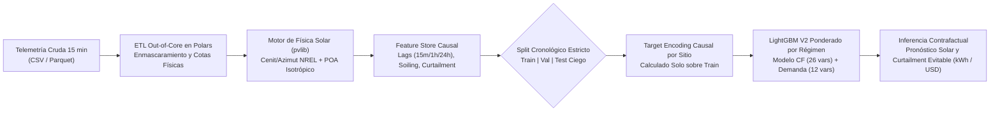
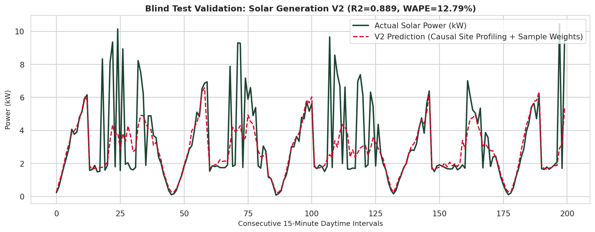
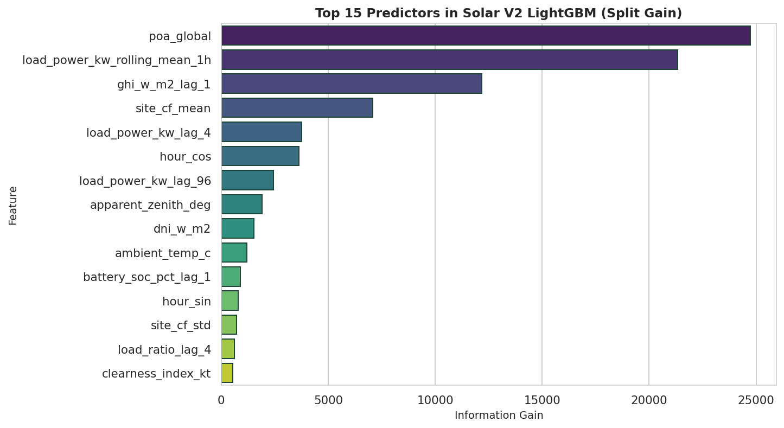
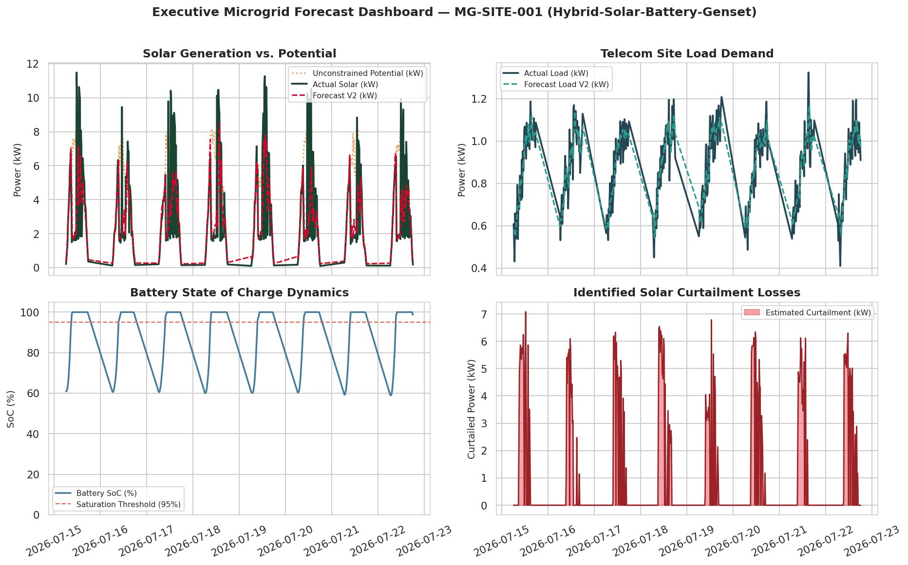
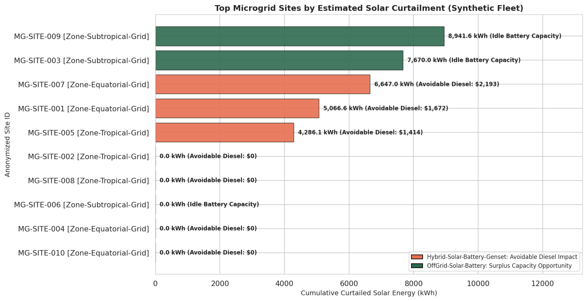
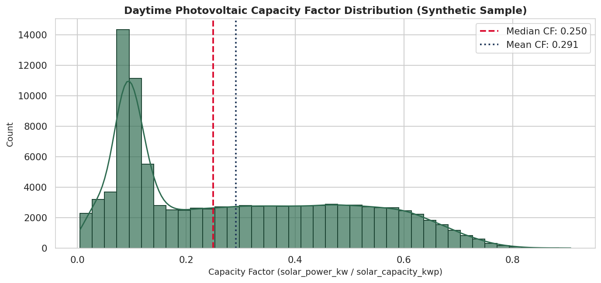
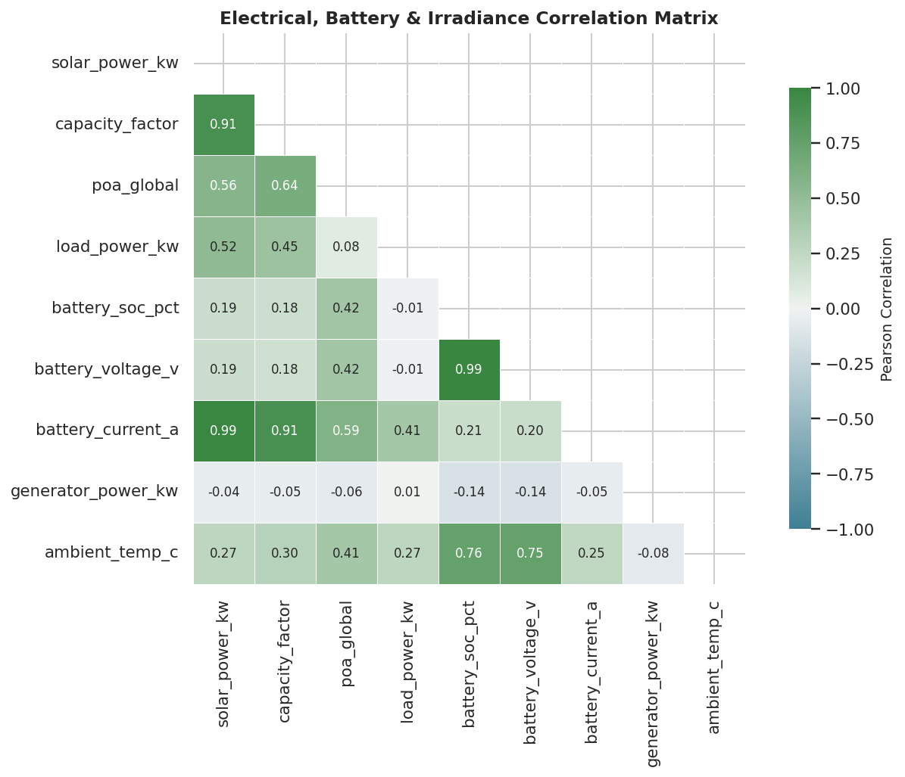

<div align="center">

# Predicción de Generación Solar (bajo Curtailment) y Demanda de Carga en Microredes Híbridas

**Pipeline de Machine Learning Informado por Física a 15 Minutos (`Polars` · `pvlib` · `LightGBM`)**

[](https://www.python.org/)
[](https://pola.rs/)
[](https://lightgbm.readthedocs.io/)
[](https://pvlib-python.readthedocs.io/)
[](#pruebas-y-controles-de-confidencialidad)
[](LICENSE)

**Idioma / Language:** [English](README.md) | **Español (Versión Completa)**

</div>

---

## Resumen Ejecutivo

Las microredes híbridas de telecomunicaciones aisladas o con red eléctrica inestable (*Off-Grid / Bad-Grid*, compuestas por Arreglo Fotovoltaico + Banco de Baterías + Motogenerador Diésel de Respaldo) sufren con frecuencia **curtailment solar** (recorte de generación): cuando las baterías alcanzan saturación (`SoC >= 95%`) y la demanda de la antena es baja (`< 1.0 kW`), el inversor limita la potencia fotovoltaica incluso bajo cielo despejado. Los modelos ingenuos de irradiancia a potencia confunden este recorte operativo con fallas de sensores o sobreestiman la generación diurna, distorsionando la planificación de ahorro de diésel y el dimensionamiento de almacenamiento.

Este repositorio implementa una **arquitectura predictiva V2 libre de fugas temporales (*zero-leakage*)**, diseñada para procesar decenas de millones de registros de telemetría cada 15 minutos (`80.4M+` filas en benchmarks históricos a escala de flota) y ejecutarse de forma 100% reproducible sobre un **dataset sintético físicamente calibrado** (`data/sample/microgrid_sample_15min.parquet`).

> **Aviso de Confidencialidad y Gobernanza de Datos:** Todos los esquemas, identificadores de sitios (`MG-SITE-001`..`MG-SITE-010`), zonas climáticas y coordenadas (`latitud`/`longitud` ubicadas estrictamente en cuadrículas sintéticas de océano abierto en el Atlántico y Pacífico únicamente para cálculos astronómicos de `pvlib`) en este repositorio público son **100% sintéticos y anonimizados**. Pruebas automáticas en CI garantizan cero tokens propietarios ni coordenadas geográficas reales.

---

## Arquitectura del Sistema



---

## Decisiones Clave de Ingeniería

### 1. Ingeniería de Telemetría Out-of-Core (`Polars`)
* Reemplaza flujos en Pandas limitados por RAM por procesamiento multihilo en Rust con `Polars` (`scan_csv().sink_parquet()`), comprimiendo telemetría masiva (`19.37 GB` en CSV crudo → `1.45 GB` en Parquet Snappy en ejecuciones a escala real).
* **Enmascaramiento de Estados Operativos:** Los intervalos desconectados (`edge_offline_alarm == 1`) se enmascaran a `null` para no entrenar sobre falsos ceros, mientras que la noche (`ghi_w_m2 == 0`) se fija determinísticamente en `0.0 kW`.
* **Auditoría Estadística de Salud (`DataHealthScorecard`):** Evalúa balance día/noche, continuidad temporal de 15 min, poda de columnas de varianza cero y exclusión de sitios con hardware inactivo (`CF máximo < 5%`).

### 2. Ingeniería de Características Basada en Física (`pvlib` + Dominio Energético)
* **Transposición Astronómica a Plano Inclinado:** Calcula cenit/azimut solar con algoritmo NREL y transpone GHI/DNI/DHI sobre la inclinación (`tilt_deg`) y orientación (`azimuth_deg`) reales de cada arreglo usando el modelo isotrópico de `pvlib` (`poa_global`), eliminando `ghi_w_m2` después para evitar multicolinealidad (VIF).
* **Índice de Claridad Solar ($k_t$):** Razón adimensional $k_t = \text{POA} / (1361 \cdot \cos\theta_z)$ acotada a $[0, 1.5]$.
* **Proxy de Suciedad / *Soiling* (`days_since_rain`):** Mide los días continuos sin lluvia de lavado natural (`precipitation_mm > 2.0 mm`) acumulados por microred.
* **Bandera Física de Curtailment y Carga Relativa:** Detecta saturación (`battery_soc_pct >= 95%`, `load_power_kw < 1.0 kW`, `poa_global > 200 W/m²`) e inyecta rezagos causales de carga relativa (`load_ratio_lag_4`).

### 3. Arquitectura Causal Anti-Leakage y Ponderación por Régimen (V2)
* **Split Cronológico Previo:** Particiona en Train (`< 2026-06-01`), Validación (`2026-06`) y Test Ciego (`>= 2026-07-01`) **antes** de calcular perfiles históricos por sitio (`site_cf_mean`, `site_cf_std`, `site_load_mean`), con *fallbacks* globales de Train para sitios no vistos.
* **Ponderación Asimétrica por Régimen Físico (*Sample Weighting*):** Prioriza eventos críticos durante el entrenamiento de LightGBM:
  * Regímenes con *curtailment* (`curtailment_state == 1`): **2.5×**
  * Picos de alta irradiancia (`poa_global >= 650 W/m²`): **1.5×**
  * Baja irradiancia / amanecer y atardecer (`poa_global <= 150 W/m²`): **1.3×**
* **Target Normalizado + Reconstrucción Física:** Predice `capacity_factor` $\in [0, 1.25]$ y reconstruye la potencia real como $\hat{P}_{\text{solar}} = \widehat{\text{CF}} \times P_{\text{kWp}}$, garantizando invarianza de escala entre microredes de 8 a 32 kWp.

---

## Resultados Cuantitativos (Benchmarks)

### Auditoría Histórica a Escala de Flota (Anonimizada: 80.47M Filas Crudas · 1,310 Sitios → 10.23M Filas Diurnas · 799 Sitios Sanos)

Evaluación estricta sobre Test Ciego futuro (`>= 2026-07-01`, `1,132,649` intervalos diurnos no vistos) comparando **V1 Base** vs. **V2 Física + Perfilado Causal**:

| Modelo y Métrica | V1 Base | Arquitectura V2 | Impacto Neto |
| :--- | :---: | :---: | :---: |
| **Solar `R²` (Potencia Real kW)** | `0.6935` | **`0.7498`** | **`+5.63 pts`** |
| **Solar `nRMSE` (Factor Capacidad p.u.)** | `0.0860` | **`0.0802`** | `-0.58%` |
| **Solar `RMSE` (kW)** | `1.356 kW` | **`1.225 kW`** | **`-130.6 W`** |
| **Solar `MAE` (kW)** | `0.815 kW` | **`0.726 kW`** | **`-89.1 W`** |
| **Solar `WAPE` (%)** | `38.36%` | **`34.16%`** | **`-4.20%`** |
| **Demanda Telecom `R²` / `WAPE`** | `0.7747` / `27.09%` | `0.7703` / `27.22%` | Modelo dedicado de 12 features (`6.31s`) |

### Benchmark Reproducible sobre la Muestra Sintética Incluida (`data/sample/microgrid_sample_15min.parquet`, `10.06 MB`)

Cualquier usuario que clone el repositorio ejecuta el flujo completo sobre `10` sitios sintéticos (`108,475` filas diurnas tras ETL):

| Modelo (Muestra Sintética) | `R²` | `nRMSE` | `RMSE` | `MAE` | `WAPE` |
| :--- | :---: | :---: | :---: | :---: | :---: |
| **Generación Solar V2** | `0.8890` | `0.0746` | `1.711 kW` | `0.794 kW` | `12.79%` |
| **Demanda Telecom V2** | `0.9908` | — | `0.070 kW` | — | `3.77%` |

---

## Validación Visual (Generada con Telemetría Sintética Anonimizada)

<details open>
<summary><strong>1. Seguimiento Solar en Test Ciego e Importancia de Variables (Gain)</strong></summary>

| Serie Real vs. Predicción V2 | Top 15 Predictoras (Ganancia) |
| :---: | :---: |
|  |  |

</details>

<details>
<summary><strong>2. Dashboard Ejecutivo de Curtailment y Ranking de Flota</strong></summary>





</details>

<details>
<summary><strong>3. Distribución Diurna del Factor de Capacidad y Matriz de Correlación</strong></summary>

| Distribución Diurna de CF | Correlaciones Eléctricas y Clima |
| :---: | :---: |
|  |  |

</details>

---

## Estructura del Proyecto

```text
solar-load-curtailment-forecasting/
├── .github/workflows/ci.yml        # CI automatizado: Ruff + Auditoría Confidencialidad + Pytest
├── configs/pipeline_v2.yaml        # Hiperparámetros, fechas de corte y umbrales físicos
├── data/
│   └── sample/
│       └── microgrid_sample_15min.parquet  # Muestra sintética calibrada (10.06 MB)
├── notebooks/
│   ├── 01_eda_physics_features.ipynb       # ETL Polars, scorecard y gráficas EDA
│   ├── 02_train_evaluate_v2.ipynb          # Split causal, LightGBM V2 y evaluación ciega
│   └── 03_inference_curtailment_demo.ipynb # Dashboard de sitio y ranking de curtailment
├── reports/figures/                # Visualizaciones limpias (solo MG-SITE-*)
├── scripts/
│   ├── generate_synthetic_sample.py        # Generador determinista pvlib + SoC batería
│   └── audit_confidentiality.py            # Escáner automático contra fugas y GPS reales
├── src/microgrid_ml/
│   ├── config.py                   # Cargador YAML y definición canónica de variables V2
│   ├── cli.py                      # Comandos CLI (`prepare-features`, `train`, `predict`)
│   ├── data/etl_polars.py          # ETL out-of-core, enmascaramiento y DataHealthScorecard
│   ├── features/solar_physics.py   # Posición solar/POA pvlib, kt, soiling y perfiles causales
│   ├── models/                     # Split temporal, sample weights, LightGBM y métricas
│   ├── inference/predictor.py      # Motor contrafactual de estimación de curtailment
│   └── visualization/plots.py      # Gráficas reproducibles con Matplotlib/Seaborn
└── tests/                          # Pruebas unitarias, anti-leakage, confidencialidad y E2E
```

---

## Guía Rápida de Ejecución (Quickstart)

### 1. Instalar paquete y dependencias
```bash
git clone https://github.com/ricardo2591/solar-load-curtailment-forecasting.git
cd solar-load-curtailment-forecasting
pip install -e ".[dev]"
```

### 2. Ejecutar el pipeline V2 completo sobre la muestra sintética (< 30 segundos)
```bash
# Opcional: regenerar dataset sintético desde cero
python scripts/generate_synthetic_sample.py

# 1) ETL + geometría solar pvlib + matriz diurna + figuras EDA
python -m microgrid_ml.cli prepare-features

# 2) Entrenar modelos V2 (Solar y Demanda) + figuras de auditoría ciega
python -m microgrid_ml.cli train

# 3) Ejecutar inferencia de curtailment en sitio + ranking de flota
python -m microgrid_ml.cli predict --site-id MG-SITE-001
```

### 3. Pruebas y Controles de Confidencialidad
```bash
ruff check src tests scripts
python scripts/audit_confidentiality.py
pytest -v
```

---

## Autor

**Ricardo Burgos** — Machine Learning & Energy Data Science  
Repositorio de portafolio diseñado para demostrar ingeniería escalable de series temporales *out-of-core*, *feature engineering* basado en física solar y sistemas predictivos libres de fugas de datos.
