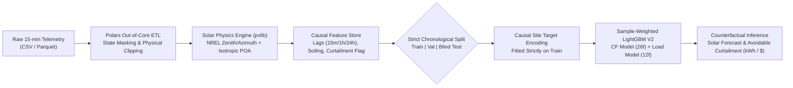
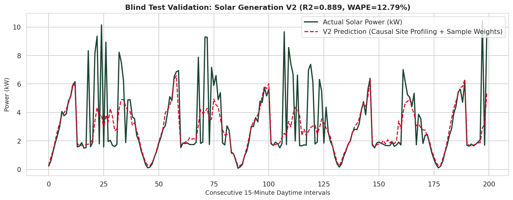
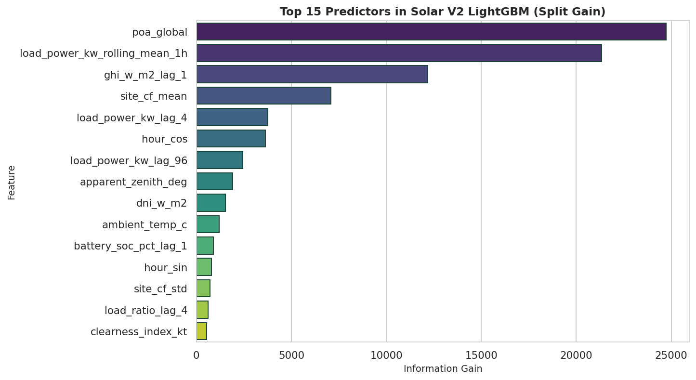
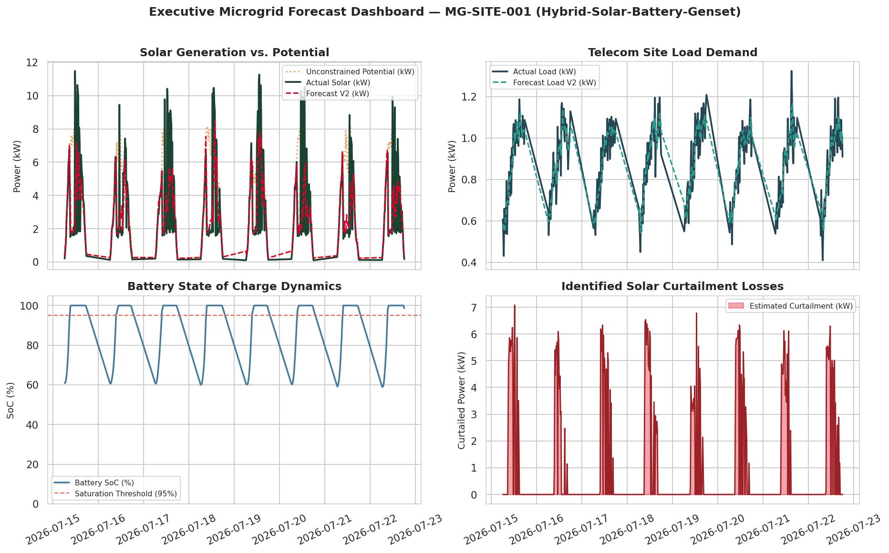
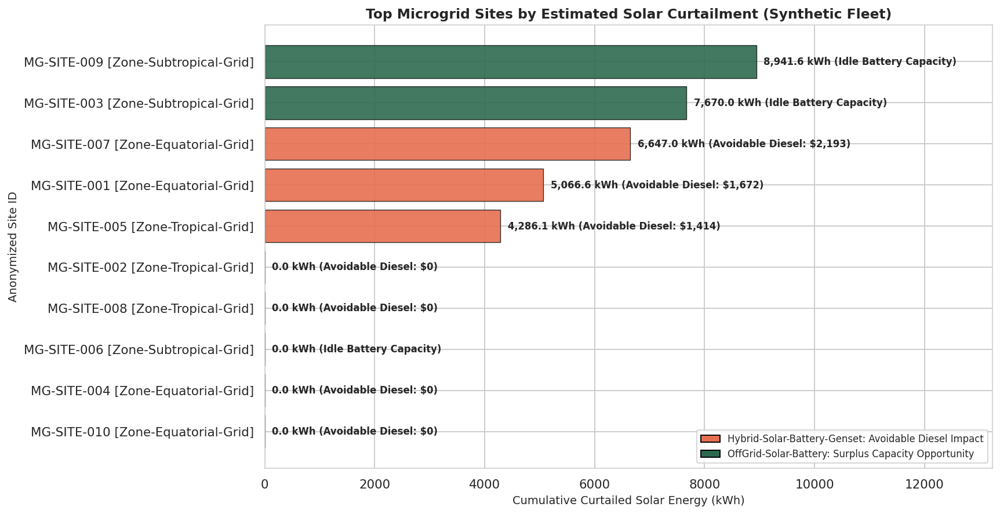
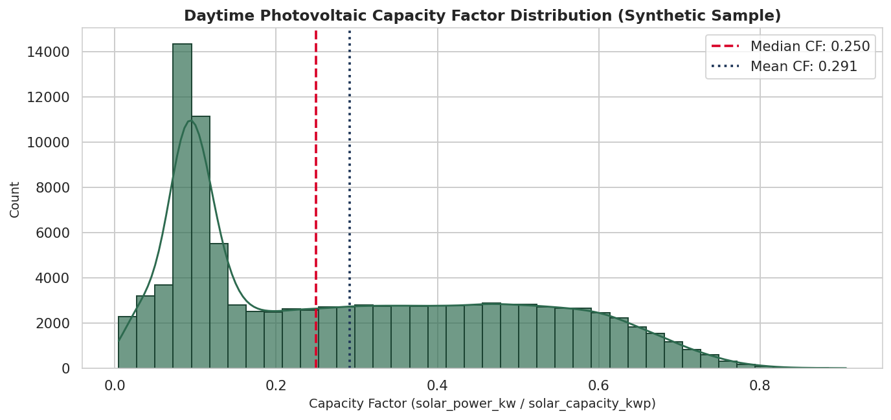
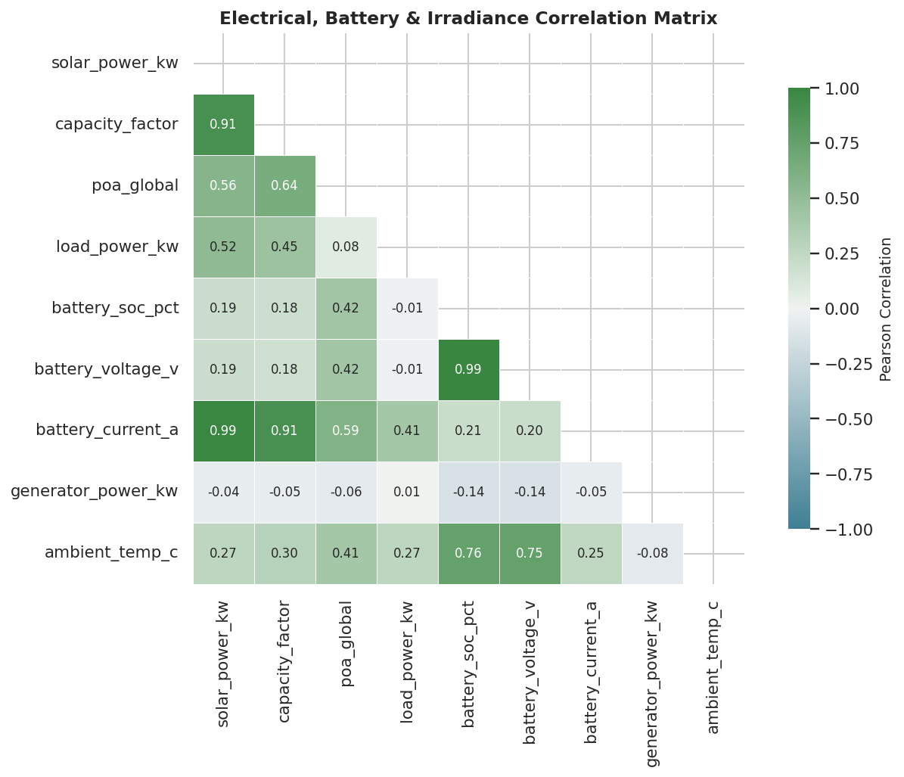

<div align="center">

# Solar Generation (Under Curtailment) & Load Demand Forecasting for Hybrid Microgrids

**15-Minute Physics-Informed Machine Learning Pipeline (`Polars` · `pvlib` · `LightGBM`)**

[](https://www.python.org/)
[](https://pola.rs/)
[](https://lightgbm.readthedocs.io/)
[](https://pvlib-python.readthedocs.io/)
[](#testing--confidentiality-guardrails)
[](LICENSE)

**Language / Idioma:** **English** | [Español (Versión Completa)](README.es.md)

</div>

---

## Executive Summary

Off-grid and bad-grid hybrid telecom microgrids (Photovoltaic Array + Lithium Battery Bank + Backup Diesel Generator) frequently experience **solar curtailment**: when batteries reach saturation (`SoC >= 95%`) and local antenna load is low (`< 1.0 kW`), inverters throttle PV output even under clear skies. Naive irradiance-to-power models mistake inverter throttling for sensor failure or overestimate daytime yield, distorting diesel-savings planning and battery sizing.

This repository packages a **production-grade, zero-leakage V2 forecasting architecture** designed to process tens of millions of 15-minute telemetry rows (`80.4M+` rows in historical fleet benchmarks) and run reproducibly out of the box on a physically calibrated **synthetic open-ocean sample dataset** (`data/sample/microgrid_sample_15min.parquet`).

> **Confidentiality & Data Governance Notice:** All telemetry schemas, site identifiers (`MG-SITE-001`..`MG-SITE-010`), climate zones, and coordinates (`latitude`/`longitude` placed strictly in mid-Atlantic and mid-Pacific open ocean boxes solely for `pvlib` solar geometry calculations) in this public repository are **100% synthetic and anonymized**. Automated CI tests enforce zero proprietary strings or real geographic coordinates across every file.

---

## System Architecture



---

## Key Engineering Highlights

### 1. Out-of-Core Streaming Telemetry Engineering (`Polars`)
* Replaces memory-bound Pandas workflows with multithreaded Rust-backed `Polars` (`scan_csv().sink_parquet()`), compressing raw multi-gigabyte telemetry (`19.37 GB` CSV → `1.45 GB` Snappy Parquet in fleet-scale runs).
* **Operational State Masking:** Edge-offline alarms (`edge_offline_alarm == 1`) are masked to `null` (preventing false zero-generation learning), while nighttime intervals (`ghi_w_m2 == 0`) are deterministically anchored to `0.0 kW`.
* **Hardware Health Filtering:** Automatically audits `DataHealthScorecard` (nighttime zero-integrity, 15-min lag continuity, near-zero-variance pruning, and dormant hardware exclusion where max capacity factor `< 5%`).

### 2. Physics-Informed Feature Engineering (`pvlib` + Domain Engineering)
* **Astronomical Transposition:** Computes NREL solar zenith/azimuth and transposes GHI/DNI/DHI onto each array's mechanical `tilt_deg` and `azimuth_deg` via isotropic `pvlib` Plane-of-Array (`poa_global`), dropping raw `ghi_w_m2` afterwards to prevent VIF collinearity.
* **Clear-Sky Index ($k_t$):** Dimensionless attenuation ratio $k_t = \text{POA} / (1361 \cdot \cos\theta_z)$ bounded to $[0, 1.5]$.
* **Soiling Degradation Proxy (`days_since_rain`):** Tracks continuous dry days per site since the last natural panel-wash event (`precipitation_mm > 2.0 mm`).
* **Physical Curtailment State & Relative Load:** Flags saturation regimes (`battery_soc_pct >= 95%`, `load_power_kw < 1.0 kW`, `poa_global > 200 W/m²`) and supplies causal lagged demand (`load_ratio_lag_4`).

### 3. Anti-Leakage Causal Architecture & Regime Weighting (V2)
* **Chronological Split First:** Partitions into Train (`< 2026-06-01`), Validation (`2026-06`), and Blind Holdout Test (`>= 2026-07-01`) **prior** to computing `site_cf_mean`, `site_cf_std`, and `site_load_mean` (with global Train fallbacks for unseen sites).
* **Asymmetric Regime Sample Weighting:** Emphasizes physically critical operating regimes during LightGBM training:
  * Curtailment events (`curtailment_state == 1`): **2.5×**
  * Peak solar irradiance (`poa_global >= 650 W/m²`): **1.5×**
  * Low irradiance / twilight ramps (`poa_global <= 150 W/m²`): **1.3×**
* **Normalized Target + Physical Reconstruction:** Predicts `capacity_factor` $\in [0, 1.25]$ and reconstructs power as $\hat{P}_{\text{solar}} = \widehat{\text{CF}} \times P_{\text{kWp}}$, ensuring scale invariance across 8–32 kWp microgrids.

---

## Quantitative Benchmark Results

### Historical Production-Scale Audit (Anonymized Fleet: 80.47M Raw Rows · 1,310 Sites → 10.23M Daytime Rows · 799 Healthy Sites)

Strict blind-holdout evaluation (`>= 2026-07-01`, `1,132,649` unseen daytime intervals) comparing **V1 Baseline** vs. **V2 Physics + Causal Site Profiling**:

| Model & Metric | V1 Baseline | V2 Architecture | Net Improvement |
| :--- | :---: | :---: | :---: |
| **Solar `R²` (Real Power kW)** | `0.6935` | **`0.7498`** | **`+5.63 pts`** |
| **Solar `nRMSE` (Capacity Factor p.u.)** | `0.0860` | **`0.0802`** | `-0.58%` |
| **Solar `RMSE` (kW)** | `1.356 kW` | **`1.225 kW`** | **`-130.6 W`** |
| **Solar `MAE` (kW)** | `0.815 kW` | **`0.726 kW`** | **`-89.1 W`** |
| **Solar `WAPE` (%)** | `38.36%` | **`34.16%`** | **`-4.20%`** |
| **Telecom Load `R²` / `WAPE`** | `0.7747` / `27.09%` | `0.7703` / `27.22%` | Dedicated 12-feature model (`6.31s` train) |

### Included Reproducible Synthetic Sample Benchmark (`data/sample/microgrid_sample_15min.parquet`, `10.06 MB`)

Every clone runs the complete pipeline end-to-end on `10` synthetic sites (`108,475` daytime intervals after ETL):

| Model (Synthetic Sample) | `R²` | `nRMSE` | `RMSE` | `MAE` | `WAPE` |
| :--- | :---: | :---: | :---: | :---: | :---: |
| **Solar Generation V2** | `0.8890` | `0.0746` | `1.711 kW` | `0.794 kW` | `12.79%` |
| **Telecom Load Demand V2** | `0.9908` | — | `0.070 kW` | — | `3.77%` |

---

## Visual Validation (Generated from Anonymized Synthetic Telemetry)

<details open>
<summary><strong>1. Blind Test Solar Tracking & Split-Gain Feature Importance</strong></summary>

| Blind Test Forecast vs. Actual | Top 15 Predictors (Split Gain) |
| :---: | :---: |
|  |  |

</details>

<details>
<summary><strong>2. Executive Site Curtailment Dashboard & Fleet Opportunity Ranking</strong></summary>





</details>

<details>
<summary><strong>3. Daytime Capacity Factor Distribution & Variable Correlations</strong></summary>

| Daytime CF Distribution | Electrical & Irradiance Correlations |
| :---: | :---: |
|  |  |

</details>

---

## Project Structure

```text
solar-load-curtailment-forecasting/
├── .github/workflows/ci.yml        # Automated Ruff + Confidentiality Audit + Pytest CI
├── configs/pipeline_v2.yaml        # Hyperparameters, split boundaries, physical thresholds
├── data/
│   └── sample/
│       └── microgrid_sample_15min.parquet  # Physics-calibrated synthetic sample (10.06 MB)
├── notebooks/
│   ├── 01_eda_physics_features.ipynb       # Polars ETL, scorecard & EDA plots
│   ├── 02_train_evaluate_v2.ipynb          # Causal split, LightGBM V2 training & evaluation
│   └── 03_inference_curtailment_demo.ipynb # Site curtailment dashboard & fleet ranking
├── reports/figures/                # Reproducible visualizations (MG-SITE-* only)
├── scripts/
│   ├── generate_synthetic_sample.py        # Deterministic pvlib + battery SoC sample builder
│   └── audit_confidentiality.py            # Pre-commit/CI guardrail against PII & real GPS
├── src/microgrid_ml/
│   ├── config.py                   # YAML loader & canonical V2 feature sets
│   ├── cli.py                      # CLI entrypoints (`prepare-features`, `train`, `predict`)
│   ├── data/etl_polars.py          # Out-of-core ETL, masking & DataHealthScorecard
│   ├── features/solar_physics.py   # pvlib solar position/POA, kt, soiling, causal profiles
│   ├── models/                     # Chronological split, sample weights, LightGBM & metrics
│   ├── inference/predictor.py      # Counterfactual curtailment quantification engine
│   └── visualization/plots.py      # Publication-grade Matplotlib/Seaborn charts
└── tests/                          # Unit, leakage, confidentiality & E2E tests
```

---

## Quickstart

### 1. Install package and dependencies
```bash
git clone https://github.com/ricardo2591/solar-load-curtailment-forecasting.git
cd solar-load-curtailment-forecasting
pip install -e ".[dev]"
```

### 2. Run the full V2 pipeline on the included synthetic sample (< 30 seconds)
```bash
# Optional: regenerate synthetic sample dataset
python scripts/generate_synthetic_sample.py

# 1) ETL + pvlib solar geometry + Gold daytime features + EDA figures
python -m microgrid_ml.cli prepare-features

# 2) Train V2 Solar & Load LightGBM models + blind-test audit figures
python -m microgrid_ml.cli train

# 3) Run site counterfactual curtailment inference + fleet ranking plots
python -m microgrid_ml.cli predict --site-id MG-SITE-001
```

### 3. Testing & Confidentiality Guardrails
```bash
ruff check src tests scripts
python scripts/audit_confidentiality.py
pytest -v
```

---

## Author

**Ricardo Burgos** — Machine Learning & Energy Data Science  
Portfolio repository built to showcase scalable out-of-core time-series engineering, physics-informed feature design, and leakage-free forecasting systems.
